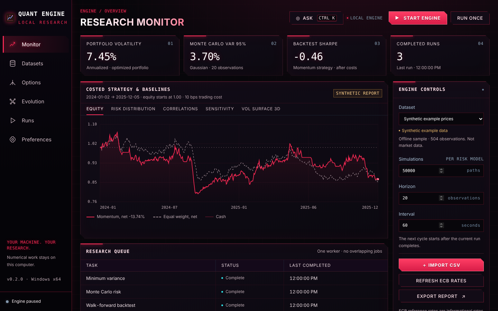

# Quant Engine

<p align="center">
  <a href="https://github.com/purysho/QuantEngine/releases/latest/download/QuantEngine-win-x64.zip"></a>
  <br>
  <sub><a href="https://github.com/purysho/QuantEngine/releases/latest">Release notes and SHA-256</a> · Windows 10/11 64-bit · portable, no installer · Python, NumPy and SciPy included</sub>
</p>

**Getting started**

1. Click the red **Download** button above. The file is `QuantEngine-win-x64.zip`, about **220 MB**. GitHub's green **Code → Download ZIP** gives only the source code (a few MB, with no `QuantEngine.exe`).
2. Check it (optional): run `(Get-FileHash .\QuantEngine-win-x64.zip -Algorithm SHA256).Hash` in PowerShell and compare the result with the SHA-256 on the [release page](https://github.com/purysho/QuantEngine/releases/latest).
3. Extract the whole zip into a new folder, for example `D:\QuantEngine-0.2.0`, and open `QuantEngine\QuantEngine.exe` from the extracted folder, not from inside the zip.
4. To confirm everything works, run `.\QuantEngine.exe --self-test | Out-String` in that folder. It should print `QUANT_SELF_TEST_OK`.

Research data is stored in `D:\Quant-Engine` by default. The app is not code-signed; if Windows SmartScreen says it is unrecognised, choose **More info, then Run anyway**. If the download is slow or stalls, see [Downloading](docs/USER_GUIDE.md#downloading-troubleshooting) in the user guide.



An independent local desktop application for continuous numerical research. It calculates covariance, constrained portfolios, Gaussian/block-bootstrap/Student-t risk with exact empirical tails, next-close costed momentum backtests, baselines, stress and parameter sensitivity, and prices options (Black–Scholes Greeks, CRR trees, Monte Carlo, implied volatility). Completed reports retain their source snapshots, seeds, parameters and software versions.

Python research modules, each with tests and a measured experiment in `experiments/results/`:

| Module | What it does |
| --- | --- |
| `quant_options` | BSM and Greeks, European/American CRR, antithetic Monte Carlo, implied volatility, SVI surface and static-arbitrage checks |
| `quant_validation` | Purged chronological ridge with information clocks; leaked features are rejected before scoring |
| `quant_pairs` | ADF / Engle–Granger with MacKinnon inference (matches statsmodels to 1e-13), Holm pair selection, costed next-close pairs backtest |
| `quant_lob` | Avellaneda–Stoikov market making with FIFO queue, partial fills, latency, fees and adverse selection |
| `quant_varbacktest` | Kupiec/Christoffersen VaR backtests; GARCH-t and **GJR-GARCH filtered historical simulation** (best on 100 years of real data) |
| `quant_data` | FRED and Kenneth French data library adapters with SHA-256-verified local caching (raw data never committed) |
| `quant_evolve` / `quant_learning` | Prequential evolutionary model search (incl. a NumPy neural network) with experience memory; runs after every continuous cycle |
| `quant_explain` | Step-by-step workings ("show the maths") for every reported number, verified against the engine and SymPy |

Desktop highlights: a Cyberpunk-styled workbench with live 3D volatility surfaces, a 3D "second mind" lineage graph of everything the engine has learned, an **Ask** panel (Ctrl+K; dictate with Handy) with permissioned actions and undo, and "The maths" panels for options and risk.

See the [work log](docs/WORK_LOG.md) for what worked and what did not, and the [research index](docs/research/RESEARCH_INDEX.md) for how each curriculum topic maps to code.

For ordinary Windows use, extract the complete portable release and open `QuantEngine.exe`. The application contains its own Python/NumPy/SciPy runtime. Its default data folder is `D:\Quant-Engine`. The offline example is visibly synthetic; wide CSV imports and optional official ECB reference-rate snapshots supply real user-selected data.

For development:

```sh
npm ci
python3 -m pip install -r requirements.txt
npm run typecheck
npm test
npm run test:quant
npm run build
python3 experiments/options_reference.py   # likewise first_alpha, pairs_cointegration, market_making, var_backtest
python3 experiments/real_world_backtest.py # downloads FRED / Ken French data into .cache/data (not committed)
python3 experiments/evolution_real.py --offline
npm start
```

Set `QUANT_PYTHON` to a development Python executable if needed. To assemble a Windows package, first run `python packaging/prepare_runtime.py`, then `npm run package:win`; see [the complete build recipe](packaging/BUILD_FROM_SOURCE.md). Authored desktop source is in `desktop/`, renderer source in `app/ui-source.js`, and the independent numerical engine in `workers/`. The build emits `dist/main.cjs`, `dist/preload.cjs` and `app/ui.js`.

One worker runs at a time, with at most two numerical threads. Pause terminates the owned worker and recovers unfinished history immediately. Closing the window keeps work in the tray; **Quit Quant Engine** drains accepted preferences and stops work. Login launch and automatic calculation resumption are separate opt-in preferences.

[User guide](docs/USER_GUIDE.md) · [Work log](docs/WORK_LOG.md) · [Research index](docs/research/RESEARCH_INDEX.md) · [Project brief](docs/PROJECT_BRIEF.md) · [Architecture](docs/ARCHITECTURE.md) · [Build milestones](docs/BUILD_PLAN.md) · [Evaluation](docs/EVALUATION.md) · [Discovery](docs/DISCOVERY.md)

The product label is provisional. First-party source licensing has not been assigned; third-party notices/licenses remain with their dependencies.
